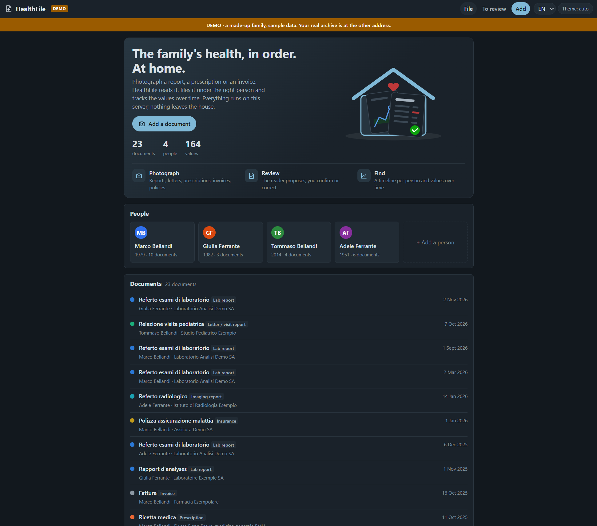
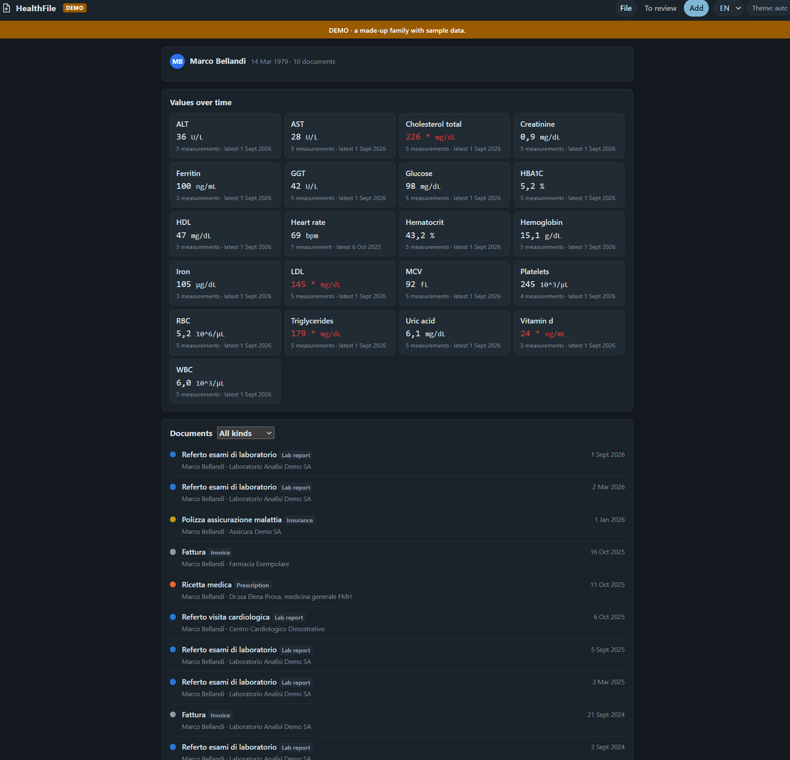
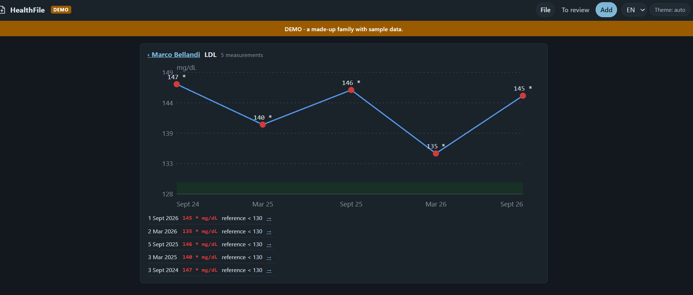
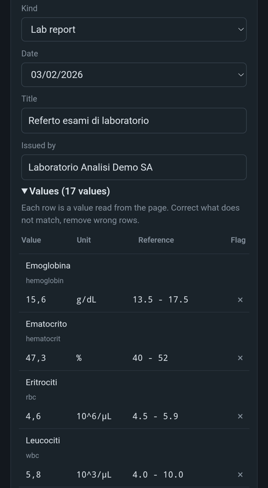
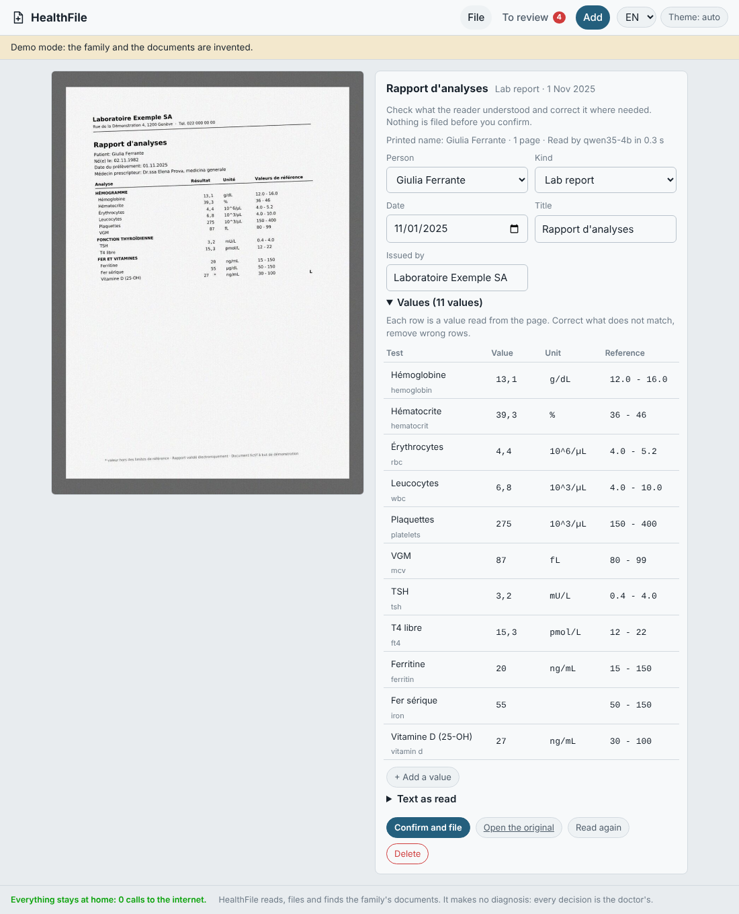

# HealthFile

Your family's health records, read, filed and found at home. You photograph
or upload a document (a lab report, a specialist's letter, a prescription, a
vaccination card, an invoice, an insurance policy); a vision model running
on the home server reads it, files it under the right person with its date
and kind, and keeps the values. You review what was read, correct it, confirm.
Then you see each person's documents on a timeline, each lab value as a
series with its reference range, and (next milestones) ask questions that
are answered from the documents, with citations.

Nothing leaves the house. Every model runs through
[`qvac serve`](https://github.com/tetherto/qvac) on the same machine, the
app has no web tools and no outbound connection at all, and the page says so
on every screen.

These screenshots are the demo copy on the home server: a fictional family
(23 PDFs in Italian and French, made by [scripts/make_corpus.py](scripts/make_corpus.py)),
every document read by Qwen3.5-4B through `qvac serve` on an RTX 3060, the
interface in English.









## What it uses from QVAC

Everything goes through [`qvac serve`](https://github.com/tetherto/qvac)'s
OpenAI-compatible API on the same machine:

- **Reading a page:** a vision model (Qwen3.5-4B with its projector) gets the
  page as an image and answers with one JSON object: kind, date, person,
  issuer, every value with its unit, range and flag, medications, follow-ups.
- **Repairing:** when the JSON is malformed, the same model fixes it in a
  second, text-only call.
- **Searching:** EmbeddingGemma turns filed documents into vectors.
- **Next:** questions answered from the documents with citations, and
  MedPsy to explain a report in plain words.

## How well it reads

The whole corpus on the home server (omen01, Qwen3.5-4B through `qvac serve`,
RTX 3060), measured with [scripts/measure-extraction.mjs](scripts/measure-extraction.mjs)
against the corpus' ground truth, 24 November 2026. The same 23 documents
twice: as the PDFs, and as phone photos of the printed pages.

| Field | PDF | Photo |
| --- | --- | --- |
| measured values found (lab results, weight, height, blood pressure, heart rate) | 170 / 170 | 167 / 170 |
| … with the exact number, unit, range and flag | 170 / 170 | 167 / 170 |
| wrong numbers | 0 | 0 |
| kind of document | 23 / 23 | 23 / 23 |
| date | 23 / 23 | 23 / 23 |
| person (printed name) | 23 / 23 | 23 / 23 |
| issuer | 22 / 23 | 22 / 23 |
| medications | 8 / 10 | 9 / 10 |
| time per document | 6–11 s a letter, prescription or invoice; 14–30 s a full lab report | about the same |

From photos, the model sometimes reads a section heading ("Emocromo") as if
it were a test: the heading gets the first row's numbers, and every name
below it lands one row early (haemoglobin with the haematocrit's 47,3 %).
That is the dangerous kind of mistake, plausible names on wrong numbers, so
two things catch it:

- each row is checked against what any patient can have for that test: a
  value, unit or range that is impossible (a haemoglobin in %, white cells
  with the platelets' range) means the row was read shifted;
- when moving the names back up by one, from the heading, clears every
  impossible row and puts each name on a unit it is printed in, the reader
  does it. The row left without its own name is shown as "?", with a note
  above the table to check the values and name it. When no such move works,
  the impossible rows stay red with the same note.

Before that check, the same photos gave 150 / 170 exact numbers, with 17
wrong ones under the right names. With it: no wrong number; the 3 values
still missing are the two "?" rows and one haemoglobin left under the
heading's name, all visible in review. The bounds are wide on purpose: they
catch reading errors, they say nothing about whether a result is normal, and
none of the 170 right values triggers them.

The remaining misses: a supplement the model writes in English ("Vitamin D3"
for "Vitamina D3"), one paediatric letter whose "continue with vitamin D" it
skips, and a pharmacy name misspelt.

What it took to get there, from the first PDF run (158 / 170 values, one
date wrong):

- dates printed day first (06.12.2025) are checked against the page's own
  text, so a month-first reading is put back;
- the prompt asks for measurements in letters too, not only in lab reports,
  and never for prices or amounts; "130/83 mmHg" is split into two values;
- a flag printed next to a number ("27 *") no longer hides the number;
- the transcription comes last in the answer, and the answer is streamed:
  when the model starts looping (an invoice total right-aligned with tab
  after tab, to the token limit) the request is cut off and everything
  written before it is kept. An invoice that took 88 s now takes 6 s.
- a growth percentile ("50° percentile") is not taken for a reference range;
  supplements a letter recommends count as medications; a test name with
  one letter misread in a photo ("Piastreine") still finds its test.

The older mock-mode screenshots:




## What it is not

HealthFile reads, files, searches and charts the family's own documents. It
does not interpret symptoms, suggest diagnoses, treatments or dosages, compute
risk scores or raise alerts from values. The "explain this report" feature of
a later milestone describes what a document says and which questions to bring
to the doctor; its output sits next to the source and under a fixed line that
the doctor decides. These are design constraints, checked by tests, not
disclaimers; they keep the product outside the medical-device definitions
while giving a family most of the value. [SPEC.md](SPEC.md) section 9 says why.

## Status

M1 of [SPEC.md](SPEC.md): ingestion, review, people, timeline, values and
series. Next: Ask with citations (M2), explain with MedPsy, reminders and the
export for the doctor (M3).

## Run

Requirements: Node 22.5 or later (it uses `node:sqlite`), `pdftoppm` and
`pdfinfo` (poppler-utils), `convert` and `identify` (ImageMagick), optionally
`heif-convert` for HEIC photos; a `qvac serve` with a vision model, an
embedding model and, later, MedPsy.

```sh
git clone https://github.com/cloudeeo/healthfile && cd healthfile
npm start                      # http://127.0.0.1:8097, data in ~/.local/share/healthfile
MOCK=1 npm start               # no qvac serve: a fake reader answers from the corpus
node scripts/load-corpus.mjs   # in another terminal: the fictional family's 23 documents, read and filed
npm test
```

Configuration is by environment (see [deploy/healthfile.service](deploy/healthfile.service)):

| Variable | Default | Meaning |
| --- | --- | --- |
| `PORT`, `HOST` | `8097`, `127.0.0.1` | On omen01 the unit uses 8096; `deploy/install-omen01.sh` installs the tools, the unit and publishes it on the tailnet (HTTPS, port 8443). |
| `DATA_DIR` | `~/.local/share/healthfile` | Originals, page images and the SQLite database, mode 0700. |
| `QVAC_URL` | `http://127.0.0.1:11434/v1` | `qvac serve`'s OpenAI-compatible API. |
| `QVAC_KEY_FILE` | `~/qvac-lab/api-key.txt` | Read per request, never logged. Empty string: no key. |
| `READER_MODEL` | `qwen35-4b` | The vision model that reads pages (needs a projector: `projectionModelSrc` in the serve config). |
| `WRITER_MODEL` | `qwen35-4b` | Repairs malformed JSON; answers questions from M2. |
| `EMBED_MODEL` | `embgemma` | Embeddings for search. |
| `EXPLAIN_MODEL` | `medpsy` | MedPsy alias for M3; empty hides the feature. |
| `LANG_DEFAULT` | `it` | The family's language; each browser can change it (it / fr / en). |
| `MAX_FILE_MB`, `MAX_PAGES` | `20`, `30` | Upload limits. |
| `DEMO` | unset | `1` for the demo copy: a DEMO band on every page, its own installable app name, and the only archive the corpus scripts write to. |

The `qvac serve` aliases this expects, in `serve.models` of `qvac.config.json`:

```json
"qwen35-4b": { "type": "llamacpp-completion", "src": "/path/Qwen3.5-4B-Q4_K_M.gguf", "preload": true,
               "config": { "device": "gpu", "projectionModelSrc": "/path/Qwen3.5-4B.mmproj-Q8_0.gguf", "mmproj-use-gpu": true, "ctx_size": 16384, "reasoning_budget": 0 } },
"embgemma":  { "type": "llamacpp-embedding", "src": "/path/embeddinggemma-300M-Q8_0.gguf", "preload": true, "config": { "device": "cpu" } }
```

## The real archive and the demo

Two copies run side by side on omen01, from the same code and the same
`qvac serve`, with nothing in common but the models:

| | The family's archive | The demo |
| --- | --- | --- |
| Unit | `healthfile` | `healthfile-demo` (`DEMO=1`) |
| Port, tailnet | 8096, `https://…:8443/` | 8098, `https://…:8444/` |
| Data | `~/.local/share/healthfile` | `~/.local/share/healthfile-demo` |
| Content | real documents | the fictional Bellandi/Ferrante family |

The demo says so on every page (an amber DEMO band, "HealthFile · Demo" in
the tab, "HF Demo" when installed on a phone) and asks not to add real
documents, so a screenshot or a shared screen can never show the family's
records. Install it with `bash deploy/install-omen01.sh --demo`, then fill it:

```sh
node scripts/reset-demo.mjs          # empty the demo, upload the corpus photos, read them with the real model, confirm them
node scripts/reset-demo.mjs --pdf    # the same from the PDFs
node scripts/reset-demo.mjs --empty  # only empty it
```

`reset-demo.mjs` refuses any HealthFile that is not the demo copy, and
`load-corpus.mjs` refuses a real archive unless given `--force`.

## Importing a folder

To load many documents at once without the page, point the import script at
a folder on the server; it walks subfolders, sends every PDF and photo, and
skips files already in the archive (the server compares SHA-256), so it can
be run again after adding files:

```sh
node scripts/import-folder.mjs ~/scansioni/salute              # the reader guesses each person from the printed name
node scripts/import-folder.mjs ~/scansioni/marco --person "Marco Bellandi"
node scripts/import-folder.mjs ~/scansioni --dry-run            # list only
node scripts/import-folder.mjs ~/scansioni --wait               # and print what was read
```

Documents land in "To review"; nothing is filed without a look.

## How a document is read

1. The upload is saved as it came (never modified). PDF pages are rendered at 150 dpi; photos are auto-oriented and resized to 1600 px on the long side. A 1200 px preview per page is kept for the screen.
2. Each page goes to the reader with one prompt that asks for a single JSON object: language, kind, date, the printed name, the issuer, a title, every measured value as printed (lab results, and weight, height, blood pressure in letters: name, value, unit, reference, flag), medications, follow-ups, an amount, and last the full text transcribed. The answer is streamed: if the model starts repeating itself, the request is cut off and everything written before the loop is kept. A second pass with the text model repairs answers that are not valid JSON. A date read month first is put back when the page's own text shows it day first.
3. Pages are merged; values are normalised (decimal comma, `< 0.5`, ranges `3.5 - 5.1`, `< 200`), matched to a table of about 60 common analytes with their Italian, French and English names so series line up across labs, and flagged against the reference when the lab printed no flag.
4. The document waits for review: the page image beside the fields and a table of values, every cell editable, rows removable. Corrections are stored as such and count in the measurements. Confirming files the document and embeds its text for search.

## API

- `GET /api/status`: counts, the models and their state, `outboundCalls: 0`.
- `GET|POST /api/people`, `GET|PATCH|DELETE /api/people/:id`, `GET /api/people/:id/analytes`, `GET /api/people/:id/series/:analyte`.
- `POST /api/documents` with the file as the body, `X-File-Name` and optional `X-Person-Id` headers; `202` with the document in state `reading`, `409` with the existing document when the same file is already in the archive.
- `GET /api/documents?person=&state=&kind=`, `GET /api/documents/:id` (with pages, measurements, items), `PATCH` (review edits), `POST /api/documents/:id/confirm`, `POST /api/documents/:id/reread`, `DELETE`.
- `GET /api/documents/:id/page-<n>.jpg`, `GET /api/documents/:id/original`.

## Measuring the reader

`scripts/measure-extraction.mjs` uploads the synthetic corpus to a running
instance, compares what was read with the ground truth field by field and
value by value, and writes a Markdown report (`measure-extraction-pdf.md` or
`-photo.md`, with the misses per document). Documents it uploads are deleted
afterwards; documents already in the archive (the demo after `reset-demo`)
are measured as they were read and left alone. Run it against the real
reader on the server (`--pdf` for the PDFs, photos by default). The latest
run is in [How well it reads](#how-well-it-reads).

`scripts/read-page.mjs <file>` reads one page the way the app does and shows
how the model's answer starts and ends, why it stopped, and what the app keeps.

## Privacy

- All model calls go to `qvac serve` on loopback; there is no other network destination in the code, and the page shows "0 calls to the internet".
- Files and the database live under `DATA_DIR` with mode 0700; originals are never rewritten; deleting asks twice and removes files and rows.
- Logs carry document ids, page counts and timings, never text, values or names. Hosts, keys and invites are redacted from every JSON answer.
- Access is by tailnet membership. Per-person access and encrypted backups are later milestones.

## Licence

MIT.
