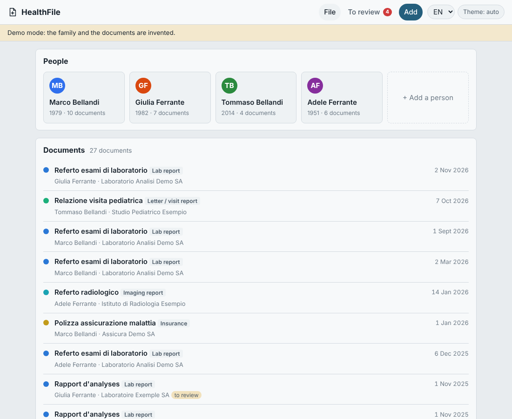
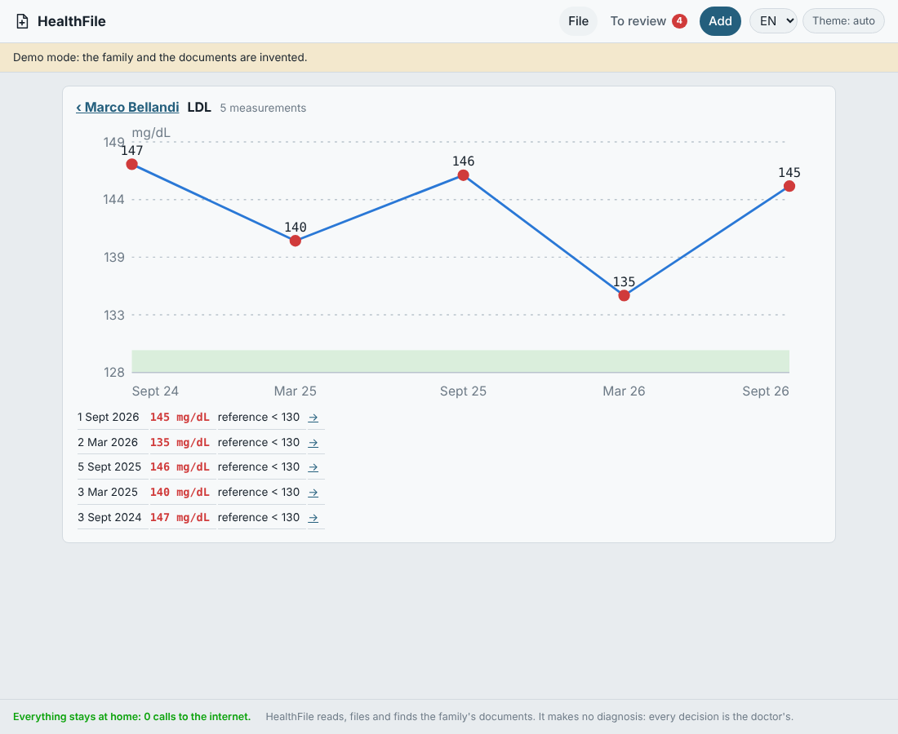
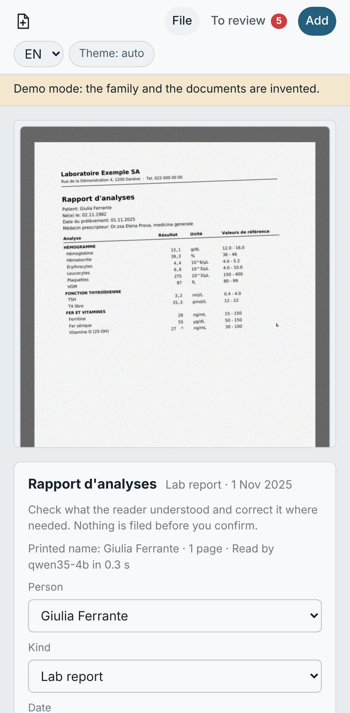

# HealthFile

Your family's health records, read, filed and found at home. You photograph
or upload a document (a lab report, a specialist's letter, a prescription, a
vaccination card, an invoice, an insurance policy); a vision model running
on the home server reads it, files it under the right person with its date
and kind, and keeps the values. You review what was read, correct it, confirm.
Then you see each person's documents on a timeline, each lab value as a
series with its reference range, and (next milestones) ask questions that
are answered from the documents, with citations.

Nothing leaves the house. Every model runs through
[`qvac serve`](https://github.com/tetherto/qvac) on the same machine, the
app has no web tools and no outbound connection at all, and the page says so
on every screen.








The screenshots are from mock mode: the family, the issuers and every number
are invented ([scripts/make_corpus.py](scripts/make_corpus.py)).

## What it is not

HealthFile reads, files, searches and charts the family's own documents. It
does not interpret symptoms, suggest diagnoses, treatments or dosages, compute
risk scores or raise alerts from values. The "explain this report" feature of
a later milestone describes what a document says and which questions to bring
to the doctor; its output sits next to the source and under a fixed line that
the doctor decides. These are design constraints, checked by tests, not
disclaimers; they keep the product outside the medical-device definitions
while giving a family most of the value. [SPEC.md](SPEC.md) section 9 says why.

## Status

M1 of [SPEC.md](SPEC.md): ingestion, review, people, timeline, values and
series. Next: Ask with citations (M2), explain with MedPsy, reminders and the
export for the doctor (M3).

## Run

Requirements: Node 22.5 or later (it uses `node:sqlite`), `pdftoppm` and
`pdfinfo` (poppler-utils), `convert` and `identify` (ImageMagick), optionally
`heif-convert` for HEIC photos; a `qvac serve` with a vision model, an
embedding model and, later, MedPsy.

```sh
git clone https://github.com/cloudeeo/healthfile && cd healthfile
npm start                      # http://127.0.0.1:8097, data in ~/.local/share/healthfile
MOCK=1 npm start               # no qvac serve: a fake reader answers from the corpus
npm test
```

Configuration is by environment (see [deploy/healthfile.service](deploy/healthfile.service)):

| Variable | Default | Meaning |
| --- | --- | --- |
| `PORT`, `HOST` | `8097`, `127.0.0.1` | On omen01 the unit uses 8096; `deploy/install-omen01.sh` installs the tools, the unit and publishes it on the tailnet (HTTPS, port 8443). |
| `DATA_DIR` | `~/.local/share/healthfile` | Originals, page images and the SQLite database, mode 0700. |
| `QVAC_URL` | `http://127.0.0.1:11434/v1` | `qvac serve`'s OpenAI-compatible API. |
| `QVAC_KEY_FILE` | `~/qvac-lab/api-key.txt` | Read per request, never logged. Empty string: no key. |
| `READER_MODEL` | `qwen35-4b` | The vision model that reads pages (needs a projector: `projectionModelSrc` in the serve config). |
| `WRITER_MODEL` | `qwen35-4b` | Repairs malformed JSON; answers questions from M2. |
| `EMBED_MODEL` | `embgemma` | Embeddings for search. |
| `EXPLAIN_MODEL` | `medpsy` | MedPsy alias for M3; empty hides the feature. |
| `LANG_DEFAULT` | `it` | The family's language; each browser can change it (it / fr / en). |
| `MAX_FILE_MB`, `MAX_PAGES` | `20`, `30` | Upload limits. |

The `qvac serve` aliases this expects, in `serve.models` of `qvac.config.json`:

```json
"qwen35-4b": { "type": "llamacpp-completion", "src": "/path/Qwen3.5-4B-Q4_K_M.gguf", "preload": true,
               "config": { "device": "gpu", "projectionModelSrc": "/path/Qwen3.5-4B.mmproj-Q8_0.gguf", "mmproj-use-gpu": true, "ctx_size": 16384, "reasoning_budget": 0 } },
"embgemma":  { "type": "llamacpp-embedding", "src": "/path/embeddinggemma-300M-Q8_0.gguf", "preload": true, "config": { "device": "cpu" } }
```

## How a document is read

1. The upload is saved as it came (never modified). PDF pages are rendered at 150 dpi; photos are auto-oriented and resized to 1600 px on the long side. A 1200 px preview per page is kept for the screen.
2. Each page goes to the reader with one prompt that asks for a single JSON object: language, kind, date, the printed name, the issuer, a title, the full text transcribed faithfully, the lab values as printed (name, value, unit, reference, flag), medications, follow-ups, an amount. A second pass with the text model repairs answers that are not valid JSON.
3. Pages are merged; values are normalised (decimal comma, `< 0.5`, ranges `3.5 - 5.1`, `< 200`), matched to a table of about 60 common analytes with their Italian, French and English names so series line up across labs, and flagged against the reference when the lab printed no flag.
4. The document waits for review: the page image beside the fields and a table of values, every cell editable, rows removable. Corrections are stored as such and count in the measurements. Confirming files the document and embeds its text for search.

## API

- `GET /api/status`: counts, the models and their state, `outboundCalls: 0`.
- `GET|POST /api/people`, `GET|PATCH|DELETE /api/people/:id`, `GET /api/people/:id/analytes`, `GET /api/people/:id/series/:analyte`.
- `POST /api/documents` with the file as the body, `X-File-Name` and optional `X-Person-Id` headers; `202` with the document in state `reading`.
- `GET /api/documents?person=&state=&kind=`, `GET /api/documents/:id` (with pages, measurements, items), `PATCH` (review edits), `POST /api/documents/:id/confirm`, `POST /api/documents/:id/reread`, `DELETE`.
- `GET /api/documents/:id/page-<n>.jpg`, `GET /api/documents/:id/original`.

## Measuring the reader

`scripts/measure-extraction.mjs` uploads the synthetic corpus to a running
instance, compares what was read with the ground truth field by field and
value by value, deletes the documents and writes a Markdown report. Run it
against the real reader on the server (`--pdf` for the PDFs, photos by
default). Results go to `MEASUREMENTS.md` as they come, one run each,
orders of magnitude rather than benchmarks.

## Privacy

- All model calls go to `qvac serve` on loopback; there is no other network destination in the code, and the page shows "0 calls to the internet".
- Files and the database live under `DATA_DIR` with mode 0700; originals are never rewritten; deleting asks twice and removes files and rows.
- Logs carry document ids, page counts and timings, never text, values or names. Hosts, keys and invites are redacted from every JSON answer.
- Access is by tailnet membership. Per-person access and encrypted backups are later milestones.

## Licence

MIT.
